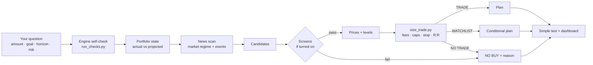

<div align="center">

# Safe US Stock Trading

**A Claude skill that turns "what should I buy?" into an exact, fee-aware, risk-capped trade plan, or an honest "no trade today".**

[](https://github.com/kldnajjar/safe-us-stock-trading/actions/workflows/checks.yml)
[](LICENSE)


[Quick start](#quick-start) · [What you get](#what-you-get) · [How it works](#how-it-works) · [Configuration](#configuration) · [Safety design](#safety-design) · [Contributing](#contributing)

</div>

> [!WARNING]
> **Research support, not financial, tax or religious advice.** The skill never logs into a broker and never places orders. You decide and you place every trade.

---

## Why

Asking an AI chatbot for stock picks usually gets you confident prose with made-up prices, no fees, no stop-loss, and no idea how much of your account is at risk.

This skill splits the work in two:

- **Claude does the research.** It reads the news, finds candidates and gathers prices and filings, with sources.
- **A tested Python engine does every number.** It sets the position size, fees, stop, targets, breakeven and portfolio limits. If the engine says no, the answer is no.

The result is a plan you can check line by line, sized to **your** broker's fees and **your** risk level.

## What you get

| Feature | What it does |
|---|---|
| 🎯 **Exact levels** | Limit buy price, stop-loss (or a review level for long-term holds), two sell targets, share counts and every fee |
| 💸 **Real costs** | Any broker's fee schedule (percent, per share, flat or commission-free), separate sell fees, FX only when currency is actually converted, plus spread and slippage |
| 🛡️ **Portfolio-wide limits** | Per-stock and per-ETF caps, sector caps (ETFs looked through), total open risk, cash floor, max positions |
| 📰 **News-driven context** | Fed, BLS, BEA, Treasury and SEC first, then major outlets; every release is read against expectations, not fixed rules |
| 🥇 **Gold / silver signal** | Six-factor score; factors that can't be verified lower confidence instead of counting as zero |
| ☪️ **Optional Shariah screen** | AAOIFI SS-21, MSCI Islamic (two series), S&P Shariah or Dow Jones Islamic, from a versioned and sourced rules registry, with purification in USD |
| ✊ **Optional boycott screen** | UN OHCHR settlements database, BDS, AFSC Investigate, Who Profits, SEC filings; the status is computed from evidence, never typed in |
| 📊 **Dashboard every run** | One self-contained HTML page with your portfolio, the limits you've used, and a BUY / WAIT / NO BUY card for each idea, showing why |

Both screens are **off unless you turn them on**.

### Plain-language output

```text
RISK: BALANCED. HOLD: SHORT.
MARKET: CALM. FED WAIT.
GOLD/SILVER: WAIT.

BUY ABC
  PRICE 100.00 (LIMIT)  SHARES 10  COST $1,005.00
  STOP 94.00  PLANNED LOSS AT STOP $70.67
  LOSS CAN BE MORE. IF PRICE JUMPS DOWN: $117.41
  SELL 5 AT 112.00  SELL 5 AT 119.00
  PROFIT IF BOTH HIT $143.15 (AFTER FEES)
  AFTER FIRST SELL: KEEP STOP 94.00. NEVER LOWER. CAN RAISE TO 101.11 (REST NO LOSS).
  HALAL: OK (SS-21)
  GIVE $0.10 TO CHARITY (FY2025)
  BOYCOTT: NOT ON LISTS
  PRICE SEEN 2026-11-05T15:30:00-05:00 (DELAYED 15M, Yahoo Finance) PRICE 100.00. GOOD ONLY FOR THIS PRICE.
  CHECK PRICE IN APP FIRST.
  CHECK APP CAN DO STOP ORDER. IF NOT: SET ALERT, SELL BY HAND.

NO BUY XYZ: boycott screen: excluded

YOU DECIDE. YOU PLACE ORDER. NOT ADVICE.
```

### Dashboard

<p align="center">
  
  <br><sub>Test data, not real positions. Light and dark mode, works on a phone.</sub>
</p>

## Quick start

**Requirements:** Python 3.9+ (standard library only; nothing to install) and Claude with skills enabled.

**1. Get it**

```bash
git clone https://github.com/kldnajjar/safe-us-stock-trading
cd safe-us-stock-trading
```

**2. Verify it**

```bash
python3 safe-us-stock-trading/scripts/run_checks.py   # prints "ok": true
```

**3. Install it**

| Where | How |
|---|---|
| **Claude apps** (web, desktop) | `zip -r safe-us-stock-trading.skill safe-us-stock-trading -x '*/__pycache__/*'`, then upload the file in Claude's skill settings |
| **Claude Code** | `cp -r safe-us-stock-trading ~/.claude/skills/` |

**4. Ask**

- *"What should I buy with $5,000? Long term, balanced."*
- *"Plan a short-term trade on AAPL and MSFT."*
- *"Review my holdings and tell me what to sell."*
- *"Is now a good time to add gold?"*

The first time, it asks for your platform and fees, which screens you want, your tax residency, and your current holdings, cash and open orders.

## How it works



| Step | Who | Output |
|---|---|---|
| Research: news, candidates, prices, filings | Claude | Cited facts with dates |
| Screens | `boycott_screen.py`, `shariah_screen.py` | Result files tied to ticker and ISIN, which expire |
| Portfolio state | `portfolio_state.py` | Actual and projected exposure, open risk, cash |
| Sizing and gates | `size_trade.py` + `fees.py` | `TRADE` / `WATCHLIST` / `NO TRADE` with every figure |
| Presentation | `render_simple.py`, `render_dashboard.py` | Text and HTML; numbers copied, never recomputed |

### Risk profiles

| Limit (% of total portfolio) | Safe | Balanced | Aggressive |
|---|:-:|:-:|:-:|
| Single stock | 5% | 10% | 15% |
| Single diversified ETF | 25% | 35% | 40% |
| Planned loss per idea | 0.5% | 1% | 2% |
| Max total open downside | 3% | 6% | 10% |
| Max per sector | 20% | 30% | 40% |
| Settled-cash floor | 20% | 10% | 5% |
| Max stock + ETF positions | 6 | 8 | 10 |
| Min net reward:risk | 2.5 | 2.0 | 2.0 |

These limits are conservative design defaults, not proven optimal allocations. Leveraged and inverse ETFs, options and PTPs are never used.

## Configuration

### Add your broker

Fee profiles live in [`brokers.json`](safe-us-stock-trading/scripts/brokers.json). There is **no default fee schedule**: without one, the engine returns NO TRADE.

1. Copy a template (`template-percent`, `template-per-share`, `template-flat`, `template-zero`) and give it a new id.
2. Fill in your schedule and remove `"template": true`.
3. Run `run_checks.py`.

```jsonc
// rates are fractions: 0.005 = 0.5%  (0.1 or more is rejected as a likely mistake)
"my-broker": {
  "name": "My Broker, US stocks",
  "fee": {
    "model": "percent", "rate": 0.0025, "min": 5.0, "max": 50.0,
    "sell": { "model": "percent", "rate": 0.003, "min": 5.0, "max": 50.0 },  // optional
    "fx_pct": 0.004                                                          // optional
  },
  "min_order": 100.0, "currency": "USD",
  "cash_interest": "unknown", "order_types": "unverified",
  "source": "user-provided", "verified_source": null
}
```

To keep a personal schedule out of public commits, put it in `brokers.local.json` (git-ignored) and pass `--brokers path/to/brokers.local.json`. Want your broker included for everyone? [Open a broker profile request](https://github.com/kldnajjar/safe-us-stock-trading/issues/new?template=broker_profile.yml).

### Shariah methodology registry

[`methodologies.json`](safe-us-stock-trading/scripts/methodologies.json) is the **only** source of Shariah thresholds. Each entry records the provider, document version, effective date, official URL, date verified, exact ratios and comparators, buffers, multi-period rules, purification method and evidence. The screen returns `UNVERIFIED` when the provider publishes an unlisted version, an entry is older than `max_age_days`, or an entry is disabled.

| Methodology | Version in registry (verified 2026-11-05) |
|---|---|
| AAOIFI | SS-21 |
| MSCI Islamic Index Series | May 2025 |
| MSCI Islamic M-Series | May 2025 |
| S&P Shariah | October 2026 (effective 2026-09-21) |
| Dow Jones Islamic Market | September 2026 (effective 2026-09-18) |

The skill never edits this file during a session. Updates go through a PR; see [CONTRIBUTING.md](CONTRIBUTING.md).

## Safety design

<details open>
<summary><b>Numbers and gates</b></summary>

- Every number in a plan comes from the scripts, never from the model. An engine error means NO TRADE.
- Inputs must be finite and in range; sector weights must lie between 0 and 1 and sum to 1; dates can't be in the future or stale.
- Caps count everything in a ticker: holdings, open orders, planned buys and related share classes.
- A stop further below any entry than the profile and horizon allow is rejected. **A stop is never lowered** after taking partial profit.
- Breakevens include every exit cost and are rounded up to the cent.
- Every price must be a whole number of cents; off-grid prices are rejected, never rounded.
- Sizing is bounded: prices under $1 are rejected and share counts are found by binary search.
</details>

<details>
<summary><b>Quotes and orders</b></summary>

- Freshness is checked against the **system clock**: a live quote may be at most 15 minutes old; a delayed quote, at most its stated delay (20 minutes max) plus 15 minutes. Anything else gives a WATCHLIST entry with a conditional plan.
- An entry more than 1% above the quoted market price, or a market price at or below the stop, is NO TRADE.
- A plan stays **provisional** until you confirm the exact limit order in your own app. Short- and medium-term plans are marked ready only when the stop can be handled (a stop order, or a manual stop you accept).
</details>

<details>
<summary><b>Portfolio state</b></summary>

- Every order states buy or sell and a known status (open / partial / filled / cancelled) with consistent whole-share quantities. Sell orders reserve no cash and can't exceed the shares held.
- Money with no sector data counts as **Unclassified, worst case**: it is checked against every sector a new buy touches, so missing data can't hide a breach.
- A holding with no stop, or one already past its level, blocks new trades until you fix it in the app.
</details>

<details>
<summary><b>Screens</b></summary>

- Screen modes are required arguments, never silently defaulted. A flag-mode screen with no result file is labelled **SCREEN NOT RUN**.
- Boycott and Shariah verdicts must come from result files that match the ticker, asset type and ISIN, haven't expired, and give the same verdict when recomputed from their recorded inputs. This is a consistency check, not tamper-proofing.
- Market-cap dates (at most 31 days old) and Shariah certificates (at most 400 days old, with an https link) are re-checked when the trade is sized.
</details>

<details>
<summary><b>Privacy and output</b></summary>

- Portfolio state, plans and screening files are git-ignored because they can contain personal holdings.
- The dashboard loads nothing external and escapes all text, so a headline or ticker string can't inject markup.
</details>

## Project structure

```text
.
├── safe-us-stock-trading/            # the skill (this folder is what you install)
│   ├── SKILL.md                      # instructions Claude follows
│   └── scripts/
│       ├── run_checks.py             # one command: files + registries + all tests
│       ├── size_trade.py             # sizing, fees, gates, exits (price trades and T-bill funds)
│       ├── portfolio_state.py        # actual vs projected portfolio, orders, risk
│       ├── fees.py                   # broker cost models
│       ├── boycott_screen.py         # boycott status computed from per-source evidence
│       ├── shariah_screen.py         # Shariah screen, result files with provenance
│       ├── render_simple.py          # plain-language text output
│       ├── render_dashboard.py       # per-run HTML dashboard
│       ├── brokers.json              # broker fee profiles and templates
│       ├── methodologies.json        # Shariah rules registry (versioned, sourced, dated)
│       └── test_*.py                 # 302 tests
├── docs/dashboard-preview.png
├── .github/                          # CI, issue and PR templates
├── CHANGELOG.md · CONTRIBUTING.md · SECURITY.md · CODE_OF_CONDUCT.md
└── LICENSE
```

## Testing

```bash
python3 safe-us-stock-trading/scripts/run_checks.py
```

It prints a JSON report and exits with code 0 only if every file is present, both registries pass schema validation, and every test passes. The skill runs it at the start of each session and drops to **watchlist-only** mode if it fails. CI runs it on Python 3.9 and 3.12 for every push and pull request.

| Test file | Covers | Tests |
|---|---|:-:|
| `test_size_trade.py` | Unit tests for sizing, fees and gates | 170 |
| `test_audit_regressions.py` | v4.1 independent audit | 16 |
| `test_integration.py` | Full command-line chain, every asset type | 21 |
| `test_v42_followup.py` | v4.2 independent audit | 6 |
| `test_v43_policy.py` | Clock, market price, stop capability, FX, dates | 31 |
| `test_v43_independent.py` | v4.3 independent audit | 5 |
| `test_v44_hardening.py` | ETF weights, buy/sell orders, bounded sizing | 19 |
| `test_v44_independent_followup.py` | v4.4 independent audit | 6 |
| `test_v45_hardening.py` | Unclassified worst case, cent grid, order states | 17 |
| `test_dashboard.py` | Verbatim numbers, safety lines, escaping | 11 |
| **Total** | | **302** |

Release history and audit fixes are in [CHANGELOG.md](CHANGELOG.md).

## Roadmap and known limits

Code can't settle these, so treat every plan as research until they're done:

- [ ] **Specialist review** of the Shariah methodology summaries (the registry checks structure, not correctness)
- [ ] **Supervised paper trading** across several sessions: stale and after-hours quotes, partial fills, cancellations, corporate actions
- [ ] **Exchange-rate model**, so non-USD accounts get executable plans (today they get research only)
- [ ] **More verified broker profiles**: [request yours](https://github.com/kldnajjar/safe-us-stock-trading/issues/new?template=broker_profile.yml)
- [ ] **Persistent tracker dashboard** (holdings, fills and stops across sessions) built on the per-run dashboard

Boycott evidence files are a record of research: they show what was found and where, not proof that each source was read correctly.

## Contributing

Contributions are welcome, especially broker fee profiles, methodology updates and tests. Start with [CONTRIBUTING.md](CONTRIBUTING.md). The one rule that matters most: **every number comes from tested code, and missing data fails closed.**

Found a way to make a plan look safer than it is? Please [report it privately](SECURITY.md) instead of opening an issue.

## License

[MIT](LICENSE) © 2026 [Khaled Al Najjar](https://www.linkedin.com/in/kldnajjar)

## Disclaimer

For research and education only. Not investment, tax or religious advice. Fee schedules are user-provided unless marked verified. Methodology summaries may lag provider updates; the registry and fail-safe checks reduce that risk but don't remove it. Markets can gap through stops, and **losses can exceed the planned amount**. The MIT License's "as is", no-warranty terms apply in full.
