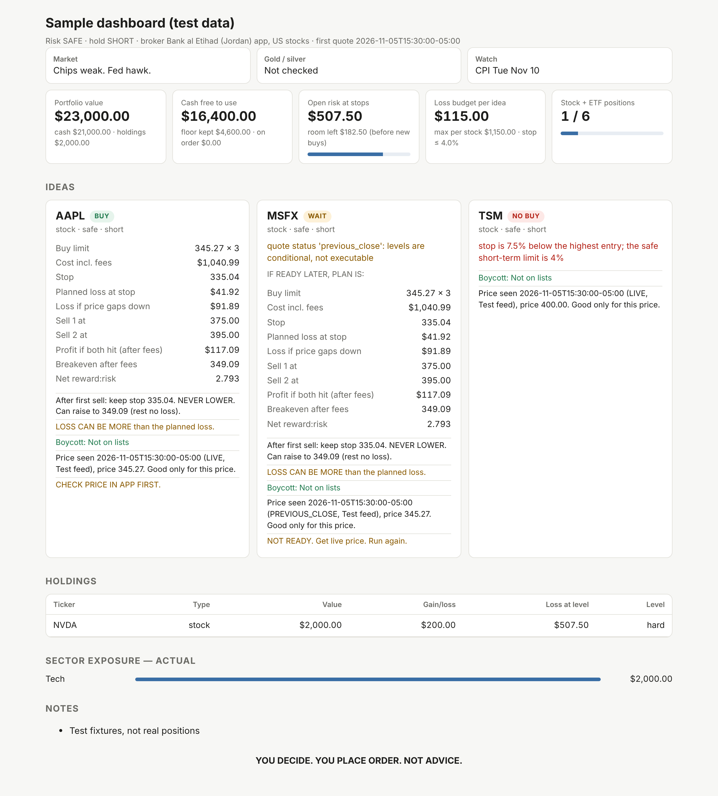
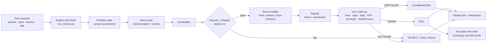

<div align="center">

# Safe US Stock Trading

**A Claude skill that turns "what should I buy?" into an exact, fee-aware, risk-capped, halal- and boycott-screened trade plan, or an honest "no trade today" with the reason.**

[](https://github.com/kldnajjar/safe-us-stock-trading/actions/workflows/checks.yml)
[](LICENSE)


[Status](#status-ready-for-paper-trading) · [Quick start](#quick-start) · [What you get](#what-you-get) · [Why NO TRADE](#why-youll-often-see-no-trade) · [How it works](#how-it-works) · [Configuration](#configuration) · [Safety design](#safety-design) · [Contributing](#contributing)

</div>

> [!WARNING]
> **Research support, not financial, tax or religious advice.** The skill never logs into a broker and never places orders. You decide and you place every trade.

---

## Why

Asking an AI chatbot for stock picks usually gets you confident prose with made-up prices, no fees, no stop-loss, and no idea how much of your account is at risk.

This skill splits the work in two:

- **Claude does the research.** It reads the news, finds candidates and gathers prices and filings, and records every source it uses.
- **A tested Python engine does every number and every check.** It handles the position size, fees, stop, targets, breakeven, portfolio limits, screens, source freshness and market hours. If the engine says no, the answer is no, and it says why.

The result is a plan you can check line by line, sized to **your** broker's fees and **your** risk level.

## Status: ready for paper trading

The engine is verified: an independent recomputation matched every dollar figure to the cent ([audit record](AUDIT-v4.8.md)). Whether the strategy **makes money** is not proven yet. The built-in journal will tell you, after about 20 closed trades.

1. **Paper trade first.** Record each plan and simulated fill with `journal.py`.
2. **Then go real, small.** One or two positions whose planned loss you're fine with. Run `journal.py reconcile` against your app after every fill.
3. **Scale up only if** `journal.py report` says "positive after costs and ahead of the benchmark". If not, holding a screened ETF is the better choice, and the report says so.

## What you get

| Feature | What it does |
|---|---|
| 💬 **One question at a time** | A short guided interview with tap-to-answer options; answered questions are skipped, "not sure" takes a safe default |
| 🎯 **Exact levels** | Limit buy price, stop-loss (or a review level for long-term holds), two sell targets, share counts and every fee |
| 💸 **Real costs** | Any broker's fee schedule (percent, per share, flat or commission-free), separate sell fees, FX only when currency is actually converted, spread and slippage. Unverified fee schedules are labelled on every plan |
| 🛡️ **Portfolio-wide limits** | Per-stock and per-ETF caps, sector caps (ETFs looked through), total open risk, cash floor, max positions |
| ☪️ **Shariah screen, always on** | AAOIFI SS-21, MSCI Islamic (two series), S&P Shariah or Dow Jones Islamic, from a versioned and sourced registry, with purification in USD (always rounded up) |
| ✊ **Boycott screen, always on** | UN OHCHR settlements database, BDS, AFSC Investigate, Who Profits, SEC filings, plus bl00d.money as an optional extra (a match flags); the status is computed from evidence, never typed in |
| 🔎 **Fresh, ranked, shown sources** | Every number is a ledger entry from a ranked source (official > wire/press > data sites), checked for freshness and the right site; two price sources must agree; company financials come only from SEC filings |
| ❓ **Every NO BUY explained** | Every reason in plain words, the facts behind it (which list, which ratio, which source is stale), what would fix it, and what else is still needed |
| 📈 **Signals** | Long-only momentum, earnings momentum, low volatility, trend and market filters from *151 Trading Strategies*; AVOID is refused |
| 🕰️ **Market-hours aware** | NYSE regular session, holidays and early closes; outside them you get a conditional WAIT plan |
| 📰 **News-driven context** | Fed, BLS, BEA, Treasury and SEC first, then major outlets; releases are read against expectations |
| 🥇 **Gold / silver signal** | Six-factor score; unverifiable factors lower confidence instead of counting as zero |
| 📊 **Dashboard every run** | One self-contained HTML page: portfolio, limits used, a BUY / WAIT / NO BUY card per idea with every reason and its sources |
| 📒 **Trade journal** | Paper and real trades; win rate, average R, totals after fees and charity, comparison with a benchmark, reconciliation with your app |

Both screens are **always on**. You choose *exclude* (default: failing names are never planned) or *flag only* (every screened idea is shown as an option, labelled with its result and the reference behind it: which list and link, or which Shariah ratio failed; you decide).

### Plain-language output

Since v4.9 every output opens with the screens (with references), your lettered options with one recommendation, and the steps to follow in your app:

```text
SCREENS (EVERY IDEA, WITH REFERENCES):
  GLDM: BOYCOTT NOT ON LISTS | HALAL HALAL IF YOU ACCEPT
    BOYCOTT REF: 5 SOURCES CHECKED 2026-11-09: OHCHR, BDS, AFSC, WHOPROFITS, SEC
    HALAL REF: structure verified from fund documents, but no Shariah certificate
  XYZ: BOYCOTT ON BOYCOTT LIST | HALAL NOT HALAL
    BOYCOTT REF: LISTED BY: AFSC https://investigate.afsc.org/company/xyz
    HALAL REF: METHOD SS-21 - interest_debt 41% > 30%

YOUR OPTIONS:
  A. BUY 19 GLDM AT 78.00 LIMIT. RISK $71.10 (GAP $142.06). PROFIT IF TARGETS HIT $287.41.
  B. BUY 10 XYZ AT 50.00 LIMIT. ... [BOYCOTT ON BOYCOTT LIST / HALAL NOT HALAL]
  C. KEEP CASH. $0 RISK, $0 GAIN.
  RECOMMENDED: A. CLEAN ON BOTH SCREENS AND PASSES YOUR RISK RULES.
  OPTIONS B: FAILED A CHECK. SHOWN BECAUSE YOU CHOSE FLAG. YOUR DECISION.

WHAT TO DO NOW:
  1. IN YOUR APP: LIMIT BUY 19 GLDM AT 78.00, GOOD-TILL-CANCEL.
  2. WHEN IT FILLS: STOP ORDER AT 75.10 FOR ALL SHARES.
  3. THEN SELL ORDERS: 9 AT 88.60, 10 AT 99.00.
```

The per-idea details follow (example from v4.8):

```text
RISK: BALANCED. HOLD: MEDIUM.
NYSE: OPEN. CLOSES 16:00 NEW YORK TIME.

BUY ABC
  PRICE 100.00 (LIMIT)  SHARES 9  COST $904.50
  STOP 90.00  PLANNED LOSS AT STOP $98.55
  LOSS CAN BE MORE. IF PRICE JUMPS DOWN: $138.85
  SELL 4 AT 120.00  SELL 5 AT 130.00
  PROFIT IF BOTH HIT $219.85 (AFTER FEES)
  AFTER FIRST SELL: KEEP STOP 90.00. NEVER LOWER. CAN RAISE TO 101.01 (REST NO LOSS).
  FEE SCHEDULE: USER-PROVIDED, NOT VERIFIED. CHECK FEES IN YOUR APP.
  FEES: $9.90 IN AND OUT = 5.5% OF PROFIT AT FIRST TARGET
  EARNINGS: 2027-01-28 (84 DAYS).
  TREND: OK (SHORT AVERAGES NOT ALIGNED (MA3 > MA10 > MA21 FAILS): NO SHORT-TERM BREAKOUT ENTRY)
  HALAL: OK (SS-21)
  CHARITY AMOUNT: UNKNOWN (DATA MISSING)
  BOYCOTT: NOT ON LISTS
  SCREEN DATA: BOYCOTT LISTS CHECKED 2026-11-04. HALAL DATA FY2025 FILED 2026-02-20. MARKET CAP 2026-11-04.
  PRICE SEEN 2026-11-05T15:30:00-05:00 (LIVE, Nasdaq) PRICE 100.00. GOOD ONLY FOR THIS PRICE.
  PRICE FROM: Nasdaq 2026-11-05 15:30 + Yahoo Finance 2026-11-05 15:31 (MATCH)
  NUMBERS FROM: SEC EDGAR 10-Q FILED 2026-10-31
  CHART DATA FROM: Stooq READ 2026-11-05 15:20
  ANALYSTS FROM: StockAnalysis READ 2026-11-05 14:10
  CHECK PRICE IN APP FIRST.
  CHECK APP CAN DO STOP ORDER. IF NOT: SET ALERT, SELL BY HAND.

NO BUY XYZ
  WHY: COMPANY IS ON A BOYCOTT LIST.
    FOUND ON: OHCHR
    - listed by: ohchr
  FIX: NONE. SKIP IT.
  (ENGINE: boycott screen: excluded)
  WHY: NOT HALAL UNDER YOUR METHOD.
    METHOD: SS-21
    - over the limit: interest_debt
  FIX: NONE. SKIP IT.
  (ENGINE: Shariah screen: excluded)

SOURCES (CHECKED 2026-11-05 20:35 UTC):
- US Bureau of Labor Statistics [OFFICIAL] 2026-10-15: CPI https://www.bls.gov/news.release/cpi.nr0.htm
- Reuters [NEWS] 2026-11-05T12:10:00Z: Fed holds https://www.reuters.com/markets/us/fed-holds/
- CNBC [NEWS] 2026-11-05T12:20:00Z: Fed holds https://www.cnbc.com/2026/11/05/fed-holds.html

YOU DECIDE. YOU PLACE ORDER. NOT ADVICE.
```

<sub>Real engine output from the test fixtures.</sub>

### Dashboard

<p align="center">
  
  <br><sub>Test data, not real positions. Light and dark mode, works on a phone.</sub>
</p>

## Quick start

**Requirements:** Python 3.9+ (standard library only; nothing to install) and Claude with skills enabled.

**1. Get it**

```bash
git clone https://github.com/kldnajjar/safe-us-stock-trading
cd safe-us-stock-trading
```

**2. Verify it**

```bash
python3 safe-us-stock-trading/scripts/run_checks.py   # prints "ok": true
```

The report also shows the NYSE clock and anything due to expire within 30 days.

**3. Install it**

| Where | How |
|---|---|
| **Claude apps** (web, desktop) | `zip -r safe-us-stock-trading.skill safe-us-stock-trading -x '*/__pycache__/*'`, then upload the file in Claude's skill settings |
| **Claude Code** | `cp -r safe-us-stock-trading ~/.claude/skills/` |

**4. Ask, during NYSE hours**

- *"What should I buy with $5,000? Long term, balanced."*
- *"Plan a medium-term trade on these tickers: …"*
- *"Review my holdings and tell me what to sell."*
- *"Is now a good time to add gold?"*

It asks **one question at a time**: first the trade (amount, what to buy, horizon, risk), then on the first run your platform, fees, how the screens are applied and your Shariah methodology, then your cash, holdings and open orders.

### When to run it

Plans are executable only while the NYSE regular session is open (09:30–16:00 New York; 13:00 on early-close days).

| Your time zone | US winter time (Nov–Mar) | US summer time (Mar–Nov) |
|---|---|---|
| Amman / Riyadh (UTC+3) | 17:30 – 24:00 | 16:30 – 23:00 |
| Dubai (UTC+4) | 18:30 – 01:00 | 17:30 – 24:00 |
| London | 14:30 – 21:00 | 14:30 – 21:00 |

## Why you'll often see NO TRADE

Usually that's the rules working, not a bug. In 7,200 realistic simulated setups with 0.5% broker fees, these were the main causes:

| Cause | What happens | What helps |
|---|---|---|
| **Market closed** | Outside NYSE hours every plan is a WAIT | Run during the session (table above) |
| **Small account** | Whole shares only; one stock is capped at 10% of the account (5% on Safe); the minimum order is $100. Below about $1,000 almost nothing fits; on Balanced the account must be at least 10× the share price | A screened ETF (35% cap), or a larger account |
| **Fees on short trades** | About 1% per round trip, and at least $2 of net profit per $1 risked is required: a 4% stop needs about an 11% target | Medium or long holds (they pass 60–70% of the time vs about 40% for short) |
| **Screens** | Strict boycott and Shariah screens remove many large US companies before sizing | Flag-only widens the pool; you judge each flagged name |
| **Missing or stale data** | No fresh source, earnings date or trend check means WAIT, with the missing items listed | Refresh and re-run |

NO TRADE is a valid outcome. With costs like these, trading less often usually keeps more money.

## How it works



| Step | Who | Output |
|---|---|---|
| Research: news, candidates, prices, filings | Claude | One ledger entry per source (`ledger.py add`) |
| Screens | `boycott_screen.py`, `shariah_screen.py` | Result files tied to ticker, asset type and ISIN; re-checked at trade time |
| Source check | `sources_check.py` (+ `sources.json`) | FRESH / STALE / CONFLICT / BAD_SOURCE per entry; re-run when sizing |
| Signals | `signals.py` | Trend, momentum and market filters, recomputed by the engine from recorded prices |
| Portfolio state | `portfolio_state.py` | Actual and projected exposure, open risk, cash |
| Sizing and gates | `size_trade.py` + `fees.py` + `market_clock.py` | `TRADE` / `WATCHLIST` / `NO TRADE` with every figure and every reason |
| Presentation | `render_simple.py`, `render_dashboard.py` | Text and HTML; numbers copied, never recomputed |
| Record | `journal.py` | Fills, performance, reconciliation with your app |

### Risk profiles

| Limit (% of total portfolio) | Safe | Balanced | Aggressive |
|---|:-:|:-:|:-:|
| Single stock | 5% | 10% | 15% |
| Single diversified ETF | 25% | 35% | 40% |
| Planned loss per idea | 0.5% | 1% | 2% |
| Max total open downside | 3% | 6% | 10% |
| Max per sector | 20% | 30% | 40% |
| Settled-cash floor | 20% | 10% | 5% |
| Max stock + ETF positions | 6 | 8 | 10 |
| Min net reward:risk | 2.5 | 2.0 | 2.0 |

These limits are conservative design defaults, not proven optimal allocations. Leveraged and inverse ETFs, options and PTPs are never used.

## Configuration

### Add your broker

Fee profiles live in [`brokers.json`](safe-us-stock-trading/scripts/brokers.json). There is **no default fee schedule**: without one, the engine returns NO TRADE.

Built in: `bank-al-etihad-jo` (0.5% per order, $0.50 min, $30 max; user-provided) and `robinhood` (commission-free US stocks and ETFs, verified 2026-11-09 against Robinhood's fee page; the small SEC/FINRA fees on sells are covered by `--friction-bps`; US accounts are for US residents). Pass `--budget AMOUNT` so an order never exceeds the money you set aside for it.

1. Copy a template (`template-percent`, `template-per-share`, `template-flat`, `template-zero`) and give it a new id.
2. Fill in your schedule and remove `"template": true`.
3. Run `run_checks.py`.

```jsonc
// rates are fractions: 0.005 = 0.5%  (0.1 or more is rejected as a likely mistake)
"my-broker": {
  "name": "My Broker, US stocks",
  "fee": {
    "model": "percent", "rate": 0.0025, "min": 5.0, "max": 50.0,
    "sell": { "model": "percent", "rate": 0.003, "min": 5.0, "max": 50.0 },  // optional
    "fx_pct": 0.004                                                          // optional
  },
  "min_order": 100.0, "currency": "USD",
  "cash_interest": "unknown", "order_types": "unverified",
  "source": "user-provided", "verified_source": null
}
```

Until `verified_source` is set, every plan prints "FEE SCHEDULE: USER-PROVIDED, NOT VERIFIED". To keep a personal schedule out of public commits, put it in `brokers.local.json` (git-ignored) and pass `--brokers path/to/brokers.local.json`. Want your broker included for everyone? [Open a broker profile request](https://github.com/kldnajjar/safe-us-stock-trading/issues/new?template=broker_profile.yml).

### Registries

Maintainers edit these through a PR (see [CONTRIBUTING.md](CONTRIBUTING.md)); the skill never edits them during a session. `run_checks.py` warns 30 days before each goes stale, and after that the affected checks refuse to pass.

| File | What | Re-check | Current |
|---|---|---|---|
| [`methodologies.json`](safe-us-stock-trading/scripts/methodologies.json) | Shariah thresholds, versions, purification methods | every 120 days | verified 2026-11-05 · due 2027-03-05 |
| [`sources.json`](safe-us-stock-trading/scripts/sources.json) | Accepted sources, tiers, freshness rules per data type | every 180 days | verified 2026-11-09 · due 2027-05-08 |
| [`market_clock.py`](safe-us-stock-trading/scripts/market_clock.py) | NYSE holidays and early closes | yearly | 2026–2027 from nyse.com |

| Shariah methodology | Version in registry |
|---|---|
| AAOIFI | SS-21 |
| MSCI Islamic Index Series | May 2025 |
| MSCI Islamic M-Series | May 2025 |
| S&P Shariah | October 2026 (effective 2026-09-21) |
| Dow Jones Islamic Market | September 2026 (effective 2026-09-18) |

### Faster data (optional)

Claude's sandbox blocks most finance sites by default. Allowing `sec.gov`, `data.sec.gov`, `finance.yahoo.com` and `stooq.com` under Claude Settings > Capabilities cuts manual lookups.

## Safety design

<details open>
<summary><b>Numbers and gates</b></summary>

- Every number in a plan comes from the scripts, never from the model. An engine error means NO TRADE.
- Inputs must be finite and in range; sector weights must lie between 0 and 1 and sum to 1 (case and spacing variants of a sector name are merged); dates can't be in the future or stale.
- Caps count everything in a ticker: holdings, open orders and planned buys. Related share classes count toward the cap but never unlock the max-positions limit.
- A stop further below any entry than the profile and horizon allow is rejected. **A stop is never lowered** after taking partial profit.
- Conservative money math: losses and costs round up, profits round down, breakevens and charity round up. Unfilled buy orders count their unpaid fee as risk.
- Every price must be a whole number of cents; prices under $1 are rejected; share counts are found by binary search.
- Short-term trades: refused when fees eat more than 25% of the first target's profit; never held through earnings unless you accept the gap risk.
</details>

<details>
<summary><b>Quotes, sources and market hours</b></summary>

- Executable only while the NYSE regular session is open, with a quote from the current session at most 15 minutes old (a delayed quote: its stated delay, 20 minutes max, plus 15).
- Every number is a ledger entry, re-checked against the system clock when the trade is sized. The checks cover: the right source for that data type, a URL on that source's own site, freshness, the latest release or filing, two price sources within 0.5%, and two outlets or one official source per news claim. The market price must be a recorded quote.
- An entry more than 1% above the quoted market price, or a market price at or below the stop, is NO TRADE.
- A plan stays **provisional** until you confirm the exact limit order in your app. Short- and medium-term plans are marked ready only when the stop can be handled.
</details>

<details>
<summary><b>Screens and result files</b></summary>

- Both screens are mandatory. `off` is NO TRADE, and flag mode without a result file is NO TRADE.
- Result files are **re-checked, not trusted**:
  - screen expiry is recomputed from each result's own date
  - boycott evidence must match the asset type and ISIN
  - verdicts must match a recomputation from the recorded inputs
  - signals are recomputed from the recorded prices
  - a company can't be sized as a metal trust or T-bill fund
  - an edited plan verdict is refused by the state, output, dashboard and journal tools
- Forging a file's inputs as well isn't detected. This is a consistency check, not tamper-proofing.
- Market-cap dates (at most 31 days old) and Shariah certificates (at most 400 days old, with an https link) are re-checked when the trade is sized.
</details>

<details>
<summary><b>Portfolio state and records</b></summary>

- Every order states buy or sell and a known status (open / partial / filled / cancelled) with consistent whole-share quantities. Sell orders reserve no cash and can't exceed the shares held. Holdings and orders must be listed once each, with a known asset type.
- Money with no sector data counts as **Unclassified, worst case**, so missing data can't hide a breach.
- A holding with no stop, or one already past its level, blocks new trades until you fix it in the app.
- The journal records real fills (shares, price, fee) and a SHA-256 fingerprint of each plan. `reconcile` flags any difference from the app's share counts.
</details>

<details>
<summary><b>Privacy and output</b></summary>

- Portfolio state, plans, screening files, source ledgers and the journal are git-ignored because they can contain personal holdings.
- The dashboard loads nothing external and escapes all text, so a headline or ticker string can't inject markup.
</details>

## Project structure

```text
.
├── safe-us-stock-trading/            # the skill (this folder is what you install)
│   ├── SKILL.md                      # instructions Claude follows
│   └── scripts/
│       ├── run_checks.py             # files, registries, all tests, NYSE clock, expiry warnings
│       ├── size_trade.py             # sizing, fees and every gate (price trades and T-bill funds)
│       ├── portfolio_state.py        # actual vs projected portfolio, orders, risk
│       ├── fees.py                   # broker cost models
│       ├── boycott_screen.py         # boycott status computed from per-source evidence
│       ├── shariah_screen.py         # Shariah screen, purification, result provenance
│       ├── sources_check.py          # source-ledger freshness and accuracy check
│       ├── ledger.py                 # add / list / check / drop source entries
│       ├── signals.py                # long-only signals (151 Trading Strategies)
│       ├── market_clock.py           # NYSE session, holidays, early closes
│       ├── journal.py                # trade journal, performance report, reconcile
│       ├── render_simple.py          # plain-language text output
│       ├── render_dashboard.py       # per-run HTML dashboard
│       ├── brokers.json              # broker fee profiles and templates
│       ├── methodologies.json        # Shariah rules registry
│       ├── sources.json              # ranked source registry and freshness rules
│       └── test_*.py                 # 443 tests
├── AUDIT-v4.8.md                     # verification and treasury audit record
├── docs/dashboard-preview.png
├── .github/                          # CI, issue and PR templates
├── CHANGELOG.md · CONTRIBUTING.md · SECURITY.md · CODE_OF_CONDUCT.md
└── LICENSE
```

## Testing

```bash
python3 safe-us-stock-trading/scripts/run_checks.py
```

It prints a JSON report and exits with code 0 only if every file is present, all three registries are valid, and every test passes. The skill runs it at the start of each session and drops to **watchlist-only** mode if it fails. CI runs it on Python 3.9 (Ubuntu 24.04) and 3.13 (latest Ubuntu) for every push and pull request.

| Test file | Covers | Tests |
|---|---|:-:|
| `test_size_trade.py` | Unit tests for sizing, fees and gates | 170 |
| `test_audit_regressions.py` | v4.1 independent audit | 16 |
| `test_integration.py` | Full command-line chain, every asset type | 21 |
| `test_v42_followup.py` | v4.2 independent audit | 6 |
| `test_v43_policy.py` | Clock, market price, stop capability, FX, dates | 31 |
| `test_v43_independent.py` | v4.3 independent audit | 5 |
| `test_v44_hardening.py` | ETF weights, buy/sell orders, bounded sizing | 19 |
| `test_v44_independent_followup.py` | v4.4 independent audit | 6 |
| `test_v45_hardening.py` | Unclassified worst case, cent grid, order states | 17 |
| `test_dashboard.py` | Verbatim numbers, safety lines, escaping | 12 |
| `test_v48_mandatory.py` | v4.8 with every gate on: screens, sources, market hours, signals, earnings, fees, journal, dashboard parity, one test per review finding | 109 |
| `test_v49_actions.py` | v4.9: screens table with references, options and recommendation, flag labels, SKIPPED, `--budget`, Robinhood profile | 12 |
| `test_v50_ingest.py` | v5.0: one-command data intake (CSV, ledger, signals), colour marks, one test per v5.0 audit finding, bl00d.money extra source | 19 |
| **Total** | | **443** |

The pre-v4.8 suites switch off the three v4.8 gates (screens, sources, market hours) with a short block at the top of each file, so each keeps testing the gate it was written for. Fixtures pin the engine's clock inside the test process; the command line can't set it.

**Verification.** v4.8 went through four review rounds, and 59 findings were fixed, each with a regression test:
- an independent code review
- an end-to-end run through the real command-line tools
- an adversarial audit that tried to break every rule
- a treasury audit that rebuilt the money math blind (760 plans, 50 T-bill plans, a portfolio chain and 30 journal trades, all matching to the cent)

See [AUDIT-v4.8.md](AUDIT-v4.8.md). Release history is in [CHANGELOG.md](CHANGELOG.md).

## Roadmap and known limits

Code can't settle these, so treat every plan as research until they're done:

- [ ] **Paper trading** until the journal has about 20 closed trades (the real test of profitability)
- [ ] **Verified broker fees**: check your profile against the broker's published tariff and one real fill
- [ ] **Specialist review** of the Shariah methodology summaries (the registry checks structure, not correctness)
- [ ] **US dividend withholding** for your country (30% without a tax treaty)
- [ ] **Exchange-rate model**, so non-USD accounts get executable plans (today they get research only)
- [ ] **More verified broker profiles**: [request yours](https://github.com/kldnajjar/safe-us-stock-trading/issues/new?template=broker_profile.yml)
- [ ] **Persistent tracker dashboard** across sessions, built on the per-run dashboard and the journal

Boycott evidence files and source ledgers are records of research: they show what was found and where, not proof that each page was read correctly.

## Contributing

Contributions are welcome, especially broker fee profiles, methodology and source-registry updates, and tests. Start with [CONTRIBUTING.md](CONTRIBUTING.md). The one rule that matters most: **every number comes from tested code, and missing data fails closed.**

Found a way to make a plan look safer than it is? Please [report it privately](SECURITY.md) instead of opening an issue.

## Credits

- `market_clock.py` is ported from [trader-skill](https://github.com/Jakeschincariol/trader-skill) (`trader-alerts/alerts.py`), Copyright (c) Jake Schincariol, MIT License. The source rules in SKILL.md section 8 (filed numbers first, headlines are leads, filings beat headlines) follow the same practice.
- `signals.py` implements formulas from Kakushadze & Serur, *151 Trading Strategies* (2018), SSRN 3247865.

## License

[MIT](LICENSE) © 2026 [Khaled Al Najjar](https://www.linkedin.com/in/kldnajjar)

## Disclaimer

For research and education only. Not investment, tax or religious advice. Fee schedules are user-provided unless marked verified. Methodology summaries may lag provider updates; the registry and fail-safe checks reduce that risk but don't remove it. Markets can gap through stops, and **losses can exceed the planned amount**. Simulated or past results don't guarantee future ones. The MIT License's "as is", no-warranty terms apply in full.
